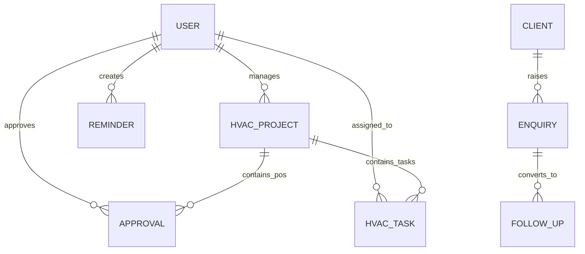

# 🗄️ Database, Data Models & Storage Architecture

This document outlines the data layer, domain entity models, local storage persistence mechanisms, and the migration path to a production relational/NoSQL database backend.

---

## 💾 Local Storage Strategy

Kelvin Mech is engineered with an **offline-first and session-persistent architecture**:

### 1. Persistent Session Engine (`SharedPreferences`)
Session authentication state and user profile fields are saved to encrypted on-device storage. When the user opens the application, [AuthService.init()](file:///c:/Users/Tushal/Desktop/HVAC/lib/features/auth/auth_service.dart) restores the active session automatically without requiring re-authentication.

| Storage Key | Data Type | Description |
| :--- | :--- | :--- |
| `is_authenticated` | `bool` | Flag indicating whether a valid session is active |
| `user_id` | `String` | Unique user identifier (e.g. `u_suresh`) |
| `user_name` | `String` | Full name of the authenticated user |
| `user_email` | `String` | Operational corporate email address |
| `user_role` | `String` | Organizational position / clearance level |
| `user_phone` | `String` | Mobile contact number |
| `user_dept` | `String` | Assigned department or division |

---

## 📊 Entity Relationship Diagram



---

## 🧩 Domain Models Specification

### 1. User Entity (`UserModel`)
Represents an authenticated team member or operator.
```dart
class UserModel {
  final String id;
  final String name;
  final String email;
  final String role;
  final String phone;
  final String department;
  final DateTime? createdAt;
}
```

### 2. MEP Project Entity (`HvacProjectModel`)
Represents a major commercial or industrial HVAC project contract.
```dart
class HvacProjectModel {
  final int id;
  final String name;             // e.g. "Airport Terminal T3"
  final double pct;              // Completion percentage (0.0 to 100.0)
  final ProjectStatus status;    // onTrack, delayed, atRisk, critical
  final String phase;            // e.g. "Execution", "Testing & Commissioning"
  final String value;            // Contract value (e.g. "₹4.2 Cr")
  final String client;           // Client name (e.g. "GMR Airports")
}
```

### 3. Follow-Up CRM Entity (`FollowUpModel`)
Tracks ongoing client and vendor communications with direct action dispatchers.
```dart
class FollowUpModel {
  final int id;
  final String contact;          // Contact person
  final String company;          // Client / Vendor organization
  final String topic;            // Meeting / Quotation / Clarification topic
  final String phone;            // Phone number for direct Call/WhatsApp
  final String project;          // Associated project reference
  final DateTime due;            // Due timestamp
  final FollowUpStatus status;   // overdue, dueToday, upcoming
  final ContactChannel channel;  // whatsapp, call, email
}
```

### 4. Purchase Order Approval Entity (`ApprovalModel`)
Manages high-value procurement requisitions requiring supervisory sign-off.
```dart
class ApprovalModel {
  final int id;
  final String po;               // PO Identifier (e.g. "PO-2024-090")
  final String vendor;           // Vendor name (e.g. "Daikin India Ltd")
  final String item;             // Requisition item summary
  final String amount;           // Formatted amount (e.g. "₹29.1L")
  final double amountInLakhs;    // Numeric value in Lakhs for KPI summation
  final int days;                // Days pending approval
  final ApprovalUrgency urgency; // high, medium, low
  final ApprovalStatus status;   // pending, approved, rejected
  final String requestedBy;      // Engineer / procurement officer name
  final String? note;            // Approval / rejection remarks
}
```

### 5. Sales Enquiry Entity (`EnquiryModel`)
Tracks incoming leads from WhatsApp, Email, Phone, or Direct Walk-in.
```dart
class EnquiryModel {
  final int id;
  final String ref;              // Enquiry reference (e.g. "ENQ-455")
  final String client;           // Client organization
  final String scope;            // Engineering scope (e.g. "Chiller replacement")
  final String value;            // Estimated project value
  final EnquirySource source;    // whatsapp, email, phone, walkin
  final EnquiryStatus status;    // newLead, estimating, sent, converted
}
```

### 6. Operational Checklist Task (`HvacTaskModel`)
Checklist item assigned to on-site project engineers.
```dart
class HvacTaskModel {
  final int id;
  final String title;            // Task summary
  final String project;          // Associated site
  final String priority;         // high, medium, low
  final DateTime due;            // Deadline
  final bool isDone;             // Checked state
}
```

### 7. Telemetry Activity Stream (`FeedActivityModel`)
Real-time audit log and activity item.
```dart
class FeedActivityModel {
  final String id;
  final String iconEmoji;        // Visual emoji icon
  final String text;             // Event summary text
  final DateTime timestamp;      // Occurrence timestamp
  final String colorTag;         // primary, success, warning, danger
  final bool isNew;              // Flash animation trigger flag
}
```

---

## 🔮 Production Backend Migration Guide

When integrating with a live cloud database (e.g., PostgreSQL / Supabase / AWS DynamoDB):

### Recommended Database Schema
```sql
-- Users Table
CREATE TABLE users (
    id UUID PRIMARY KEY DEFAULT gen_random_uuid(),
    name VARCHAR(255) NOT NULL,
    email VARCHAR(255) UNIQUE NOT NULL,
    role VARCHAR(100) NOT NULL,
    phone VARCHAR(50),
    department VARCHAR(100),
    created_at TIMESTAMP WITH TIME ZONE DEFAULT NOW()
);

-- Projects Table
CREATE TABLE projects (
    id SERIAL PRIMARY KEY,
    name VARCHAR(255) NOT NULL,
    completion_percentage NUMERIC(5, 2) DEFAULT 0.0,
    status VARCHAR(50) NOT NULL,
    phase VARCHAR(100) NOT NULL,
    contract_value VARCHAR(50),
    client_name VARCHAR(255) NOT NULL,
    created_at TIMESTAMP WITH TIME ZONE DEFAULT NOW()
);

-- Purchase Orders Table
CREATE TABLE purchase_orders (
    id SERIAL PRIMARY KEY,
    po_number VARCHAR(50) UNIQUE NOT NULL,
    vendor_name VARCHAR(255) NOT NULL,
    item_description TEXT NOT NULL,
    amount_in_lakhs NUMERIC(10, 2) NOT NULL,
    days_pending INT DEFAULT 0,
    urgency VARCHAR(20) NOT NULL,
    status VARCHAR(20) DEFAULT 'pending',
    requested_by VARCHAR(255) NOT NULL,
    approved_by UUID REFERENCES users(id),
    signoff_notes TEXT,
    updated_at TIMESTAMP WITH TIME ZONE DEFAULT NOW()
);
```

### API Endpoint Mapping
| Feature | Endpoint | HTTP Method |
| :--- | :--- | :--- |
| Authentication | `/api/v1/auth/login` | `POST` |
| Session Refresh | `/api/v1/auth/me` | `GET` |
| Projects Pulse | `/api/v1/projects` | `GET` |
| PO Approvals | `/api/v1/approvals` | `GET` |
| Approve PO | `/api/v1/approvals/:id/approve` | `POST` |
| Reject PO | `/api/v1/approvals/:id/reject` | `POST` |
| Follow-ups | `/api/v1/followups` | `GET`, `POST` |
| Snooze Follow-up | `/api/v1/followups/:id/snooze` | `PATCH` |
| Activity Feed Stream | `/api/v1/telemetry/ws` | `WebSocket / SSE` |
