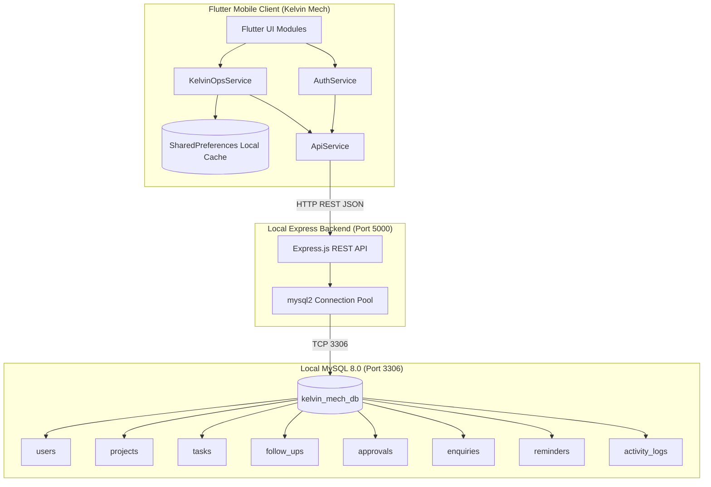

# 🗄️ Kelvin Mech — Local MySQL Setup & Integration Guide

This guide documents the local **MySQL 8.0** database architecture, automated setup procedures, REST API backend bridge, and how Kelvin Mech saves and synchronizes MEP contracting data in real time.

---

## 📑 Table of Contents

- [1. Architecture Overview](#1-architecture-overview)
- [2. Why a REST API Bridge?](#2-why-a-rest-api-bridge)
- [3. Quick Setup (1-Command Automatic Setup)](#3-quick-setup-1-command-automatic-setup)
- [4. Manual SQL Setup via CLI](#4-manual-sql-setup-via-cli)
- [5. Backend Environment Configuration (.env)](#5-backend-environment-configuration-env)
- [6. Running the Backend Server](#6-running-the-backend-server)
- [7. Mobile App Connection (Emulator vs Physical Device)](#7-mobile-app-connection-emulator-vs-physical-device)
- [8. Database Schema & Tables Reference](#8-database-schema--tables-reference)
- [9. Data Flow & Sync Lifecycle](#9-data-flow--sync-lifecycle)
- [10. Troubleshooting & Common Questions](#10-troubleshooting--common-questions)

---

## 1. Architecture Overview



---

## 2. Why a REST API Bridge?

Direct TCP connection from mobile apps (Flutter/Android) to MySQL port 3306 is **not recommended for production or mobile OS environments** for the following critical reasons:
1. **Security & Credential Exposure**: Direct database connections require embedding database credentials inside the compiled APK, creating severe vulnerabilities.
2. **Connection Pooling**: Mobile devices lose Wi-Fi/cellular signal frequently. MySQL connection pool management must reside on a server, not on client phones.
3. **Network Sandboxing**: Android and iOS enforce strict security sandboxes that restrict raw socket database protocols.
4. **Resilient Offline Fallback**: Our `ApiService` architecture transparently falls back to local cache if MySQL or the backend server is temporarily paused.

---

## 3. Quick Setup (1-Command Automatic Setup)

The repository includes an automated Node.js database installer script that creates the `kelvin_mech_db` database, applies all 8 relational tables, and inserts realistic seed data.

### Step 1: Install Backend Dependencies
```bash
cd backend
npm install
```

### Step 2: Run Database Setup
```bash
node setup_database.js
```

**Expected Terminal Output:**
```text
====================================================
 Kelvin Mech — Automated MySQL Database Initializer
====================================================
Connecting to MySQL host: localhost:3306 as user: 'root'...
✅ Connection established with MySQL Server!
Reading schema from: .../database/schema.sql
Creating database 'kelvin_mech_db' and tables...
✅ All 8 tables created successfully!
Reading seed data from: .../database/seed.sql
Populating initial MEP operations seed data...
✅ Initial seed data inserted successfully!
====================================================
 Database Summary:
  - Users:        4
  - Projects:     5
  - Approvals:    4
  - Follow-ups:   6
====================================================
🎉 Database initialization complete! Ready for backend server.
```

---

## 4. Manual SQL Setup via CLI

If you prefer to initialize MySQL manually using the command line:

```bash
# 1. Login to MySQL CLI
mysql -u root -p

# 2. Run schema and seed files from the project root:
mysql -u root -p < database/schema.sql
mysql -u root -p kelvin_mech_db < database/seed.sql
```

Alternatively, you can open MySQL Workbench, connect to `localhost:3306`, and execute:
- [schema.sql](file:///c:/Users/Tushal/Desktop/HVAC/database/schema.sql)
- [seed.sql](file:///c:/Users/Tushal/Desktop/HVAC/database/seed.sql)

---

## 5. Backend Environment Configuration (.env)

The backend server is configured via `backend/.env`.

```env
# Server Port
PORT=5000

# MySQL Database Configuration
DB_HOST=localhost
DB_PORT=3306
DB_USER=root
DB_PASSWORD=12345678
DB_NAME=kelvin_mech_db
```

> [!NOTE]
> On this local machine, the local root password is configured as `12345678`. If you run on another machine with a different MySQL root password, update `DB_PASSWORD` in `backend/.env`.

---

## 6. Running the Backend Server

Start the Node.js Express server:

```bash
cd backend
npm start
```
*(Or `node server.js`)*

### Verify Server Health
Open your browser or run:
```bash
curl http://localhost:5000/api/health
```

**Response:**
```json
{
  "status": "online",
  "platform": "Kelvin Mech Operations API",
  "database": "connected (MySQL)",
  "timestamp": "2026-10-12T11:45:11.724Z"
}
```

---

## 7. Mobile App Connection (Emulator vs Physical Device)

The Flutter mobile app automatically configures the correct network host via [ApiService](file:///c:/Users/Tushal/Desktop/HVAC/lib/core/services/api_service.dart):

| Environment | Host Used | Description |
| :--- | :--- | :--- |
| **Android Emulator** | `http://10.0.2.2:5000/api` | `10.0.2.2` is Android Emulator's default alias for host machine's `127.0.0.1` |
| **Windows Desktop / Web** | `http://localhost:5000/api` | Connects directly to local loopback interface |
| **Physical Android Phone (Wi-Fi)** | `http://192.168.x.x:5000/api` | Enter host PC's Wi-Fi IPv4 address via `ApiService.instance.setCustomBaseUrl()` |

---

## 8. Database Schema & Tables Reference

All tables are created in database `kelvin_mech_db` with `utf8mb4_unicode_ci` collation.

### 1. `users`
| Column | Type | Constraints | Description |
| :--- | :--- | :--- | :--- |
| `id` | INT AUTO_INCREMENT | PRIMARY KEY | Unique user identifier |
| `name` | VARCHAR(120) | NOT NULL | Full engineer/manager name |
| `email` | VARCHAR(150) | UNIQUE, NOT NULL | Work email address |
| `password` | VARCHAR(255) | NOT NULL | Authentication password |
| `role` | VARCHAR(100) | NOT NULL | Role (*Procurement Manager, Admin, etc.*) |
| `phone` | VARCHAR(30) | NOT NULL | Work contact number |
| `department` | VARCHAR(100) | NOT NULL | Department division |
| `avatar_url` | VARCHAR(255) | NULL | Optional avatar image link |

### 2. `projects`
| Column | Type | Constraints | Description |
| :--- | :--- | :--- | :--- |
| `id` | INT AUTO_INCREMENT | PRIMARY KEY | Project ID |
| `name` | VARCHAR(150) | NOT NULL | Project site (*Airport T3, ABC Tower*) |
| `completion_pct` | DECIMAL(5,2) | DEFAULT 0.00 | Milestone percentage (0–100%) |
| `status` | ENUM | 'onTrack', 'atRisk', 'delayed', 'critical' | Health status |
| `phase` | VARCHAR(100) | NOT NULL | Current phase (*Execution, Ducting*) |
| `contract_value` | VARCHAR(50) | NOT NULL | Contract value (*₹4.2 Cr*) |
| `client_name` | VARCHAR(120) | NOT NULL | Client (*GMR Airports, DLF*) |

### 3. `tasks`
| Column | Type | Constraints | Description |
| :--- | :--- | :--- | :--- |
| `id` | INT AUTO_INCREMENT | PRIMARY KEY | Task ID |
| `title` | VARCHAR(255) | NOT NULL | Inspection or site task title |
| `project_name` | VARCHAR(150) | NOT NULL | Associated contract name |
| `due_date` | DATETIME | NOT NULL | Due deadline timestamp |
| `priority` | ENUM | 'high', 'medium', 'low' | Urgency tier |
| `is_done` | BOOLEAN | DEFAULT FALSE | Checkbox completion status |
| `task_type` | VARCHAR(50) | DEFAULT 'task' | Type (*visit, approval, update*) |

### 4. `follow_ups`
| Column | Type | Constraints | Description |
| :--- | :--- | :--- | :--- |
| `id` | INT AUTO_INCREMENT | PRIMARY KEY | CRM follow-up ID |
| `contact_name` | VARCHAR(120) | NOT NULL | Client or vendor person name |
| `company` | VARCHAR(150) | NOT NULL | Vendor company (*Voltas, Daikin, Carrier*) |
| `topic` | VARCHAR(255) | NOT NULL | Follow-up subject |
| `phone` | VARCHAR(30) | NOT NULL | Contact phone number |
| `project_name` | VARCHAR(150) | NOT NULL | Project context |
| `due_date` | DATETIME | NOT NULL | Scheduled call/action date |
| `status` | ENUM | 'overdue', 'dueToday', 'upcoming' | SLA status |
| `channel` | ENUM | 'whatsapp', 'call', 'email' | Preferred channel |

### 5. `approvals`
| Column | Type | Constraints | Description |
| :--- | :--- | :--- | :--- |
| `id` | INT AUTO_INCREMENT | PRIMARY KEY | Approval ID |
| `po_number` | VARCHAR(50) | UNIQUE, NOT NULL | Purchase Order (*PO-2024-090*) |
| `vendor_name` | VARCHAR(150) | NOT NULL | Equipment supplier |
| `item_description` | VARCHAR(255) | NOT NULL | Equipment (*VRF Units ×8, AHU Chillers*) |
| `amount_display` | VARCHAR(50) | NOT NULL | Formatted amount (*₹29.1L*) |
| `amount_lakhs` | DECIMAL(10,2) | NOT NULL | Numeric Lakhs for calculations |
| `days_pending` | INT | DEFAULT 1 | Age of pending request |
| `urgency` | ENUM | 'high', 'medium', 'low' | Escalation level |
| `status` | ENUM | 'pending', 'approved', 'rejected' | Workflow status |
| `requested_by` | VARCHAR(100) | NOT NULL | Requesting engineer |
| `signoff_note` | TEXT | NULL | Approver/Rejecter remarks |

### 6. `enquiries`
| Column | Type | Constraints | Description |
| :--- | :--- | :--- | :--- |
| `id` | INT AUTO_INCREMENT | PRIMARY KEY | Lead Enquiry ID |
| `ref_code` | VARCHAR(50) | UNIQUE, NOT NULL | Reference code (*ENQ-452*) |
| `client_name` | VARCHAR(150) | NOT NULL | Prospective client |
| `scope_description`| TEXT | NOT NULL | Scope of work (*VRF System Block B*) |
| `estimated_value` | VARCHAR(50) | NOT NULL | Estimated quotation (*₹1.2 Cr*) |
| `source` | ENUM | 'whatsapp', 'email', 'referral', 'direct' | Inbound channel |
| `status` | ENUM | 'newLead', 'contacted', 'siteVisit', 'quoted' | Pipeline status |
| `priority` | ENUM | 'high', 'medium', 'low' | Lead temperature |
| `assigned_to` | VARCHAR(100) | NULL | Assigned sales/MEP engineer |

### 7. `reminders`
| Column | Type | Constraints | Description |
| :--- | :--- | :--- | :--- |
| `id` | INT AUTO_INCREMENT | PRIMARY KEY | Reminder ID |
| `title` | VARCHAR(255) | NOT NULL | Reminder title |
| `scheduled_time` | DATETIME | NOT NULL | Trigger timestamp |
| `reminder_type` | VARCHAR(50) | DEFAULT 'task' | Category (*call, report, approval, visit*) |
| `priority` | ENUM | 'high', 'medium', 'low' | Priority |
| `repeat_frequency` | ENUM | 'none', 'daily', 'weekly', 'monthly' | Recurrence rule |
| `is_done` | BOOLEAN | DEFAULT FALSE | Status |

### 8. `activity_logs`
| Column | Type | Constraints | Description |
| :--- | :--- | :--- | :--- |
| `id` | INT AUTO_INCREMENT | PRIMARY KEY | Log entry ID |
| `icon_emoji` | VARCHAR(10) | NOT NULL | Emoji identifier (✅, 🚨, 📥, ⚡) |
| `activity_text` | VARCHAR(255) | NOT NULL | Telemetry description |
| `color_tag` | VARCHAR(30) | DEFAULT 'primary' | Styling tag (*success, danger, warning*) |
| `created_at` | TIMESTAMP | DEFAULT CURRENT_TIMESTAMP | Event timestamp |

---

## 9. Data Flow & Sync Lifecycle

### On Mobile App Launch
1. [AuthService](file:///c:/Users/Tushal/Desktop/HVAC/lib/features/auth/auth_service.dart) initializes and restores cached credentials.
2. [KelvinOpsService](file:///c:/Users/Tushal/Desktop/HVAC/lib/core/services/kelvin_ops_service.dart) calls `syncFromMySqlBackend()`.
3. [ApiService](file:///c:/Users/Tushal/Desktop/HVAC/lib/core/services/api_service.dart) runs a 2-second non-blocking health check against `/api/health`.
4. If reachable, data from the 8 MySQL tables populates the in-memory collections and dashboard KPIs update to reflect true database counts.
5. If unreachable, the app seamlessly boots using local cached simulation data with **zero crash or lag**.

### When You Perform Actions in the Mobile App
- **Approving a PO**:
  - The app updates UI immediately (optimistic UI update).
  - Background HTTP POST `/api/approvals/:id/approve` updates `approvals` table (`status = 'approved'`) in MySQL.
- **Snoozing a Follow-up**:
  - Background HTTP PATCH `/api/followups/:id/snooze` calculates new due date and updates MySQL.
- **Toggling a Checklist Task**:
  - Background HTTP PATCH `/api/tasks/:id/toggle` flips `is_done` in MySQL.
- **Adding a Reminder**:
  - Background HTTP POST `/api/reminders` inserts a new row into `reminders` table in MySQL.

---

## 10. Troubleshooting & Common Questions

### Q1: `Access denied for user 'root'@'localhost'`
- Check `backend/.env`.
- Ensure `DB_PASSWORD` matches your local MySQL root password.
- Test in terminal:
  ```bash
  mysql -u root -p
  ```

### Q2: Android Emulator cannot reach the server
- The Android Emulator cannot reach your computer via `localhost` because `localhost` refers to the emulator itself.
- Ensure the app uses `http://10.0.2.2:5000/api` (handled automatically by `ApiService.dart`).

### Q3: How to test on a physical phone?
1. Connect your PC and phone to the same Wi-Fi network.
2. Find your PC's IP address (`ipconfig` in cmd, look for `IPv4 Address`, e.g., `192.168.1.15`).
3. Make sure port 5000 is open on Windows Firewall.
4. Set backend URL in Flutter:
   ```dart
   ApiService.instance.setCustomBaseUrl('http://192.168.1.15:5000/api');
   ```

---

## 11. Database Migrations & Automation Tooling

For ongoing database evolutions, automated versioned migrations, rollbacks, and backup & restore:
👉 See the dedicated guide: **[docs/DATABASE_SCRIPTS.md](DATABASE_SCRIPTS.md)**

```bash
# Run migrations forward
npm run db:migrate

# Rollback last migration
npm run db:migrate:down

# Create timestamped SQL backup
npm run db:backup

# Restore database from backup
npm run db:restore

# Check connection health & row counts
npm run db:check
```

